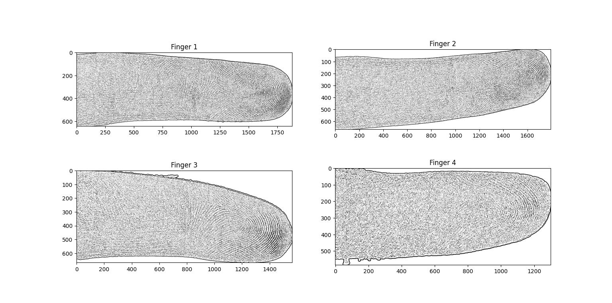

<p align="center">
  <picture>
    <source media="(prefers-color-scheme: dark)" srcset="assets/wordmark-dark.svg">
    
  </picture>
</p>

<p align="center">
  
  
  <a href="docs/ROADMAP.md"></a>
</p>

<p align="center">
  
</p>

# Fingerprint extraction and matching from images

This project provides an end-to-end, local fingerprint workflow:

1. extract candidate fingerprint crops from a hand photograph;
2. turn each usable crop into a RootSIFT feature template;
3. enroll templates in a versioned SQLite database; and
4. identify an unknown query, verify a claimed identity, or compare two crops
   through the Python API.

The database stores feature templates rather than source-image pixels. This is
an experimental image-matching system, not a certified biometric product; read
the [calibration](#calibration-and-benchmarking) and
[security](#privacy-security-and-liveness) sections before using real data.

## Requirements and installation

- Python 3.10 or newer
- OpenCV with SIFT support (the current `opencv-python` dependency provides it)
- NumPy
- Matplotlib for the optional extraction preview

Create an environment and install the declared minimum runtime dependencies:

```bash
python -m venv .venv

# Windows PowerShell
.\.venv\Scripts\Activate.ps1

# macOS or Linux instead
# source .venv/bin/activate

python -m pip install --upgrade pip
python -m pip install -e ".[dev]"
```

This installs the `fingerprint_from_image` package and two console commands,
`fingerprint-extract` and `fingerprint-match`. The original
`python fingerprint_extraction.py ...` and `python fingerprint_matching.py ...`
invocations, and `import fingerprint_matching`, keep working from a source
checkout through thin compatibility shims. `requirements.txt` remains available
for a minimal, non-editable install.

### Project layout

```text
src/fingerprint_from_image/
  extraction.py   hand-photo segmentation into fingerprint crops
  features.py     ridge ROI, quality gates, RootSIFT template creation
  pairwise.py     mutual ratio matching + affine RANSAC scoring
  matcher.py      enrollment / identification / verification service
  store.py        versioned SQLite template store
  templates.py    template and result value types
  cli/            fingerprint-extract and fingerprint-match entry points
scripts/          reproducible asset / dataset tooling
docs/ROADMAP.md   v2 plan and status
```

## Extract fingerprints from a hand image

```text
python fingerprint_extraction.py IMAGE \
  [--output-dir OUTPUT_DIR] [--no-display] [--max-fingers MAX_FINGERS]
```

For example, save up to four lossless grayscale crops without opening a GUI:

```bash
python fingerprint_extraction.py photos/hand.jpg \
  --output-dir extracted --max-fingers 4 --no-display
```

Saved files are named `finger_1.png`, `finger_2.png`, and so on in left-to-right
image order. Without `--no-display`, Matplotlib opens a preview. Without
`--output-dir`, the crops are not written to disk.

An extraction preview produced by the original workflow:



## Organize a dataset

`build` accepts either of the following layouts, or a mixture of both beneath
the same identity directory.

### Already-cropped fingerprints

Place samples under `DATASET/IDENTITY/FINGER/`. The immediate child directory
name becomes the finger label; image files below it are discovered recursively.

```text
dataset/
  alice/
    left_index/
      capture_01.png
      capture_02.png
    right_thumb/
      session_02/capture_01.tif
  bob/
    left_index/
      capture_01.png
```

### Complete hand images

Place each hand capture directly under its identity directory:

```text
dataset/
  alice/
    hand_01.jpg
    hand_02.jpg
  bob/
    hand_01.jpg
```

Every direct image is passed through the hand extractor. Its crops are labeled
`finger_1`, `finger_2`, and so on in left-to-right order. Supported dataset
extensions are BMP, DIB, JPEG/JPG, JP2, PNG, TIFF/TIF, and WebP; other files are
ignored. A dataset with identity directories but no supported images is an
error.

## Matching CLI

All matching commands use `fingerprints.db` by default. Because `--db` belongs
to each subcommand, put it after the subcommand. Operational results are emitted
as pretty-printed JSON. `build` and `enroll` create a database when necessary;
`identify`, `match`, `verify`, and `stats` require the selected database to
already exist.

### Build a database

```text
python fingerprint_matching.py build DATASET [--replace] [--db DB]
```

```bash
python fingerprint_matching.py build dataset --db fingerprints.db
```

Building is incremental: enrolling the same source again for the same identity
and finger is counted as `skipped`. Reusing the same source or identical feature
template under a different identity or finger is rejected as a conflicting
enrollment. When the selected database already exists, `--replace` builds an
entirely new database beside it and transactionally overwrites the old database
only if every recognized dataset image enrolls without failure. The successful
commit uses SQLite's transactional backup into the existing file, preserving
that file's POSIX mode or Windows ACL. A failed staged build with one or more
per-image failures exits `1`, reports
`"replacement_committed": false`, and leaves the old database intact; a
successful commit reports `true`. An invalid/empty dataset is an error (`2`),
also without changing the old file. If the database does not yet exist,
`--replace` behaves like an ordinary incremental build; successful enrollments
can remain if another source fails.

### Enroll one identity

```text
python fingerprint_matching.py enroll IDENTITY IMAGE [IMAGE ...] \
  [--finger FINGER] [--hand | --cropped] [--db DB]
```

Enroll cropped samples with an explicit anatomical label:

```bash
python fingerprint_matching.py enroll alice \
  scans/alice_index_01.png scans/alice_index_02.png \
  --finger right_index --cropped --db fingerprints.db
```

Or enroll one or more complete hand photographs:

```bash
python fingerprint_matching.py enroll alice photos/alice_hand_03.jpg \
  --hand --db fingerprints.db
```

A hand capture must yield at least two crops. Enrollment is all-or-nothing for
each capture: if any extracted crop fails quality/template creation, none of
that capture's templates are committed. This prevents a partial capture from
silently creating a sparse identity.

With neither `--hand` nor `--cropped`, the CLI deliberately treats every input
as one cropped fingerprint. `--cropped` makes that default explicit. A complete
hand photograph therefore requires `--hand`; it is never inferred by the CLI.
`--finger` defaults to `unknown` and applies to cropped inputs, not extracted
hand crops.

### Identify an unknown query

```text
python fingerprint_matching.py identify IMAGE [--top-k TOP_K] \
  [--threshold THRESHOLD] [--hand | --cropped] [--db DB]
```

```bash
python fingerprint_matching.py identify queries/unknown.png \
  --cropped --top-k 5 --threshold 0.42 --db fingerprints.db
```

The default `--top-k` is 5. Candidates are returned in descending score order.
The command succeeds even if every candidate has `"accepted": false`; use each
candidate's `accepted` field for the biometric decision. If an otherwise
accepted top candidate is less than the default `0.04` ambiguity margin ahead
of the runner-up, the winner and every returned candidate within that margin of
the winning score have `"ambiguous": true` and `"accepted": false`. This check
considers the runner-up even when `--top-k 1` returns only the winner.

### `match` alias

```text
python fingerprint_matching.py match IMAGE [--top-k TOP_K] \
  [--threshold THRESHOLD] [--hand | --cropped] [--db DB]
```

`match` is an exact CLI alias of `identify` and searches one image against the
database. It does **not** take two image paths. Use `FingerprintMatcher.match`
in Python for a direct crop-to-crop comparison.

### Verify a claimed identity

```text
python fingerprint_matching.py verify IDENTITY IMAGE \
  [--threshold THRESHOLD] [--hand | --cropped] [--db DB]
```

```bash
python fingerprint_matching.py verify alice queries/claimed_alice.jpg \
  --hand --threshold 0.42 --db fingerprints.db
```

Verification compares the query with all templates enrolled for the claimed
identity. An unknown identity is an error.

### Inspect database statistics

```text
python fingerprint_matching.py stats [--db DB]
```

```bash
python fingerprint_matching.py stats --db fingerprints.db
```

The response includes schema and feature versions, total identity/template
counts, and counts per identity and per finger label.

## JSON, scores, thresholds, and exit codes

Scores, image quality values, ratios, and coverage values are normalized to
`[0, 1]`; larger match scores are stronger. The default finger-match threshold
is `0.38`, and the default identity-acceptance threshold is `0.42`.

`--threshold` is optional on `identify`, `match`, and `verify`. It overrides the
finger and identity thresholds with the same value for that invocation. Its
accepted range is `(0, 1]` (zero is invalid). It does not alter the underlying
pairwise descriptor/geometric scores or the `0.04` ambiguity margin. It can
change identity scores and ranking, however, because only assignments meeting
the finger threshold contribute to the aggregate.

By default, the identity score is the sum of above-threshold assigned finger
scores divided by the number of query evidence slots. Acceptance requires that
score to meet the identity threshold and at least
`max(1, ceil(query_fingers * 0.5))` assignments to meet the finger threshold.
This prevents several weak ridge similarities from accumulating into an
identity acceptance.

For an explicit hand query, the denominator is the number of extracted crops,
including crops that later fail template quality checks. At least two usable
templates must remain. A four-crop query cannot therefore degrade into a
one-finger decision when three crops are unusable.

Important response fields are:

- `ok`: whether the command itself completed without enrollment/processing
  failures; it is not the biometric verdict.
- `enrollment`: `added`, duplicate `skipped`, `failed`, and per-source `errors`.
- `replacement_committed`: present when `build --replace` stages a replacement
  for an existing database; whether that staged database replaced the old one.
- `matches`: ranked identity results from `identify`/`match`.
- `match`: the claimed identity result from `verify`.
- `accepted`: the actual identity or nested finger decision.
- `matched_fingers`: how many assigned finger scores met the finger threshold;
  `query_fingers` is the number of extracted evidence slots in the denominator,
  while `usable_query_fingers` reports how many produced templates.
- `ambiguous`: for identification, whether the candidate is part of the
  near-tied leading group that was rejected; verification has no competing
  candidates and leaves it false.
- `assignments`: one-to-one query-crop to enrolled-finger-label matches, with
  score diagnostics such as mutual matches, RANSAC inliers, descriptor
  similarity, spatial coverage, and quality.

Exit status is `0` for successful build/enroll/stats/identify/match operations
and an accepted verification. It is `1` when build/enroll has one or more
failed sources or when verification completes but rejects the claim.
Framework/input errors return `2` and write
`{"ok": false, "error": "..."}` to standard error; invalid command syntax uses
argparse's standard error output. In particular, a rejected verification still
has `"ok": true` because matching completed. Likewise, an ambiguous or
otherwise rejected identification still exits `0`.

## Python API

```python
from fingerprint_matching import FingerprintMatcher

with FingerprintMatcher("fingerprints.db") as matcher:
    report = matcher.enroll(
        "alice",
        ["scans/alice_01.png", "scans/alice_02.png"],
        finger="right_index",
        kind="cropped",
    )
    candidates = matcher.identify("queries/unknown.png", kind="cropped", top_k=3)
    verification = matcher.verify("alice", "queries/claim.png", kind="cropped")
    pair = matcher.match("queries/claim.png", "scans/alice_01.png")

print(report.to_dict())
print(candidates[0].to_dict())
print(verification.accepted, pair.score)
```

`kind` may be `"cropped"`, `"hand"`, or `"auto"`. The API methods, like the CLI,
default to `"cropped"`; select `"hand"` explicitly for a hand photo. If requested
explicitly, auto mode treats an image as a hand only when extraction finds at
least two crops. For custom operating points, pass
`MatcherConfig(finger_match_threshold=..., identity_accept_threshold=...)` to
`FingerprintMatcher`. Lower-level `create_template` and `match_templates`
functions are also public when no database is needed.

The first `FingerprintMatcher` that opens a database records the settings that
shape persisted features: `max_features`, both SIFT detector thresholds, and
`max_image_dimension`. It also records the complete hand-extraction
configuration and extraction-version identifier. The current SQLite schema is
v3; it refuses incompatible schema, feature, extractor, or bound configuration
versions rather than mixing templates. Later instances must use compatible
values or opening the database fails. Acceptance, matching, and ambiguity
settings may be changed without rebuilding templates. To change a
feature-producing or extraction setting, build a fresh database with the new
configuration; clearing its enrolled templates through the Python API does not
reset these bindings.

## How matching works

1. Hand inputs use an HSV skin mask, morphology, contour filtering, and adaptive
   thresholding to produce up to four grayscale crops.
2. Each crop is converted to grayscale, bounded in size, masked to an estimated
   ridge region, and quality-checked. A gradient-orientation coherence gate
   rejects textures without sufficiently consistent fingerprint-like ridge
   flow before RootSIFT keypoints and 128-value descriptors are created.
3. Two templates are compared with mutual Lowe ratio matches. Partial-affine
   RANSAC operates on coordinates normalized by each image diagonal, making its
   geometric tolerance relative to resolution. It rejects inconsistent
   correspondences, implausible scale changes, and support concentrated in too
   small an area.
4. Inlier support, inlier ratio, descriptor similarity, spatial coverage, and
   image quality produce a normalized finger score.
5. For an identity, the best enrolled sample for each finger label is considered
   and an order-independent, one-to-one assignment maximizes the hand score.
   Below-threshold assignments contribute no identity evidence, and the default
   quorum requires at least half of the query fingers to match.
6. Identification rejects an otherwise accepted leading group as ambiguous
   when the winner's lead over the runner-up is smaller than the configured
   ambiguity margin.

SQLite stores little-endian floating-point features, metadata, feature
checksums, source hashes, and source paths. It does not store source image
pixels. Identification currently performs an exhaustive database scan, so
latency grows roughly with the number of identities and enrolled templates;
`--top-k` limits returned results, not comparisons performed.

## Testing

```bash
python -m pip install -r requirements-dev.txt
python -m pytest
```

The tests use deterministic synthetic ridge images and the repository's sample
finger panels to cover extraction, template creation and quality rejection,
geometric genuine/impostor matching, SQLite round trips and duplicate
enrollment, dataset layout, and order-independent multi-crop identification.
They also cover near-tie rejection, conflicting and concurrent duplicate
enrollment, atomic hand enrollment, and database configuration compatibility.
Passing them establishes functional correctness only; it is not evidence of
biometric accuracy on real people.

## Calibration and benchmarking

The built-in thresholds are conservative starting values, not a calibrated
operating point. Before a real deployment:

1. collect consented, representative enrollment and query captures across the
   intended sensors, resolutions, poses, lighting, and failure conditions;
2. split development and held-out evaluation data by person and capture session
   to prevent leakage;
3. create genuine pairs from the same person/finger and impostor pairs from
   different people, including difficult look-alikes and low-quality samples;
4. tune the finger and identity thresholds and matched-finger quorum on
   development data, then freeze the configuration, including an ambiguity
   margin suited to the open-set identification task; and
5. report ROC/DET curves, false-match rate (FMR/FAR), false-non-match rate
   (FNMR/FRR), equal-error rate, TAR at the required FAR, extraction/enrollment
   failure rates, and latency as the database grows.

Calibrate separately for cropped-print and hand-photo workflows and for the
number of query fingers: the identity score averages assigned evidence over the
number of query evidence slots (all extracted crops for a hand query). Do not
select thresholds from the synthetic unit tests or from the final evaluation
set.

## Current hand-extraction limitations

- The extractor selects large regions in fixed HSV skin-color bounds. Lighting,
  camera white balance, skin tone, gloves, background colors, and shadows can
  cause missed or false contours.
- It treats selected connected skin regions as candidate fingers; it does not
  locate fingertips or separate fingers joined to a palm. A normal connected
  hand silhouette can therefore become one unsuitable crop, while clutter can
  become several crops.
- It keeps at most four contours and labels them only by horizontal order.
  Mirroring, hand rotation, missing fingers, or pose changes can make
  `finger_1` refer to a different anatomical finger between captures.
- The optional Python API `kind="auto"` mode uses a two-crop heuristic and can
  misclassify an input. Both CLI and API default to a crop: explicitly select
  `--hand` or `kind="hand"` for a hand photograph.
- Hand photographs must contain enough sharply focused ridge detail after
  cropping. Typical distant phone photos may show a hand but not enough
  fingerprint texture to make a reliable template.

For serious data collection, use controlled capture geometry or a fingerprint
sensor and enroll explicit anatomical finger labels.

## Privacy, security, and liveness

Fingerprint features are sensitive biometric data. RootSIFT templates are not
cryptographically anonymous or guaranteed irreversible. The SQLite database is
not encrypted, contains identity labels and source paths, and provides no
authentication, authorization, audit log, retention policy, or key management.
Protect it with least-privilege file access and appropriate encryption, consent,
retention/deletion controls, backups, and applicable privacy law.

New database files are created with owner-only mode `0600` where the operating
system honors POSIX modes. SQLite secure deletion is enabled, and `clear()`
vacuum-rebuilds freed database pages. These measures do not erase filesystem
snapshots, backups, SSD remapping/history, or unlinked staging-file blocks, so
neither `clear()` nor `build --replace` is a forensic-erasure mechanism.

This project has no liveness or presentation-attack detection and may accept a
photo, printout, replay, synthetic ridge pattern, or other spoof. It also does
not produce standards-compliant minutiae templates and has not been evaluated
for forensic identification. Do not use it as the sole control for access,
payments, safety-critical actions, or other high-impact decisions.

## Star history

[](https://star-history.com/#m-mutti/fingerprint-from-image&Date)
