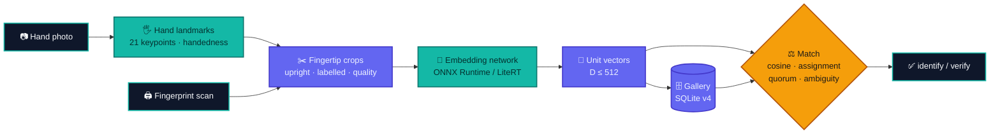
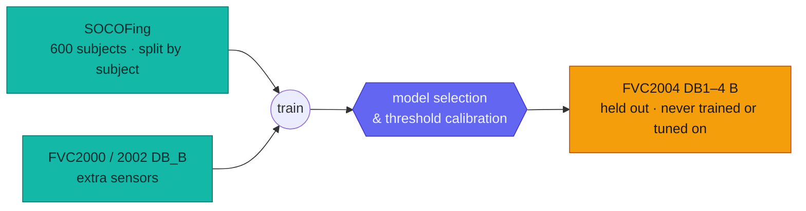
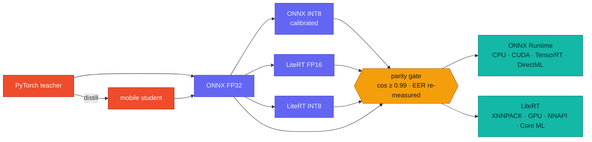

<!-- ───────────────────────────── HERO ───────────────────────────── -->
<p align="center">
  <picture>
    <source media="(prefers-color-scheme: dark)" srcset="assets/wordmark-dark.svg">
    
  </picture>
</p>

<h3 align="center">Deep-learning fingerprint recognition from phone photos and scans</h3>

<p align="center">
  Learned hand landmarks · deep fingerprint embeddings · evidence-aware matching<br>
  optimized for <b>ONNX Runtime</b> and <b>LiteRT</b> on server, mobile and edge
</p>

<p align="center">
  
  
  
  
  <br>
  
  
  
  
  <a href="docs/ROADMAP.md"></a>
</p>

<p align="center">
  <a href="#-highlights"><b>Highlights</b></a> ·
  <a href="#-how-it-works"><b>How it works</b></a> ·
  <a href="#-quick-start"><b>Quick start</b></a> ·
  <a href="#-benchmarks"><b>Benchmarks</b></a> ·
  <a href="#-edge-deployment--optimization"><b>Optimization</b></a> ·
  <a href="#-roadmap"><b>Roadmap</b></a> ·
  <a href="#-documentation"><b>Docs</b></a>
</p>

<p align="center">
  <picture>
    <source media="(prefers-color-scheme: dark)" srcset="assets/pipeline-animated.svg">
    
  </picture>
  <br>
  <sub><i>Illustrative animation. Real scores come from the benchmarks below.</i></sub>
</p>

> [!IMPORTANT]
> **v3 is in active development.** The recognizer, the embedding gallery and the
> foundations are on `main`. The embedding model, the hand detector and the
> benchmark harness are being trained and evaluated now (see [Status](#-status)).
> The classical pipeline is fully documented in [docs/CLASSIC.md](docs/CLASSIC.md),
> and the original code is preserved on the
> [`backup`](https://github.com/m-mutti/fingerprint-from-image/tree/backup) branch.

---

## ✨ Highlights

<table>
  <tr>
    <td width="33%" valign="top">
      <h4>🖐️ Photo → fingertips</h4>
      A learned hand-landmark model finds all five fingertips in an ordinary phone photo and returns upright, high-resolution crops labelled <code>right_index</code>, <code>left_thumb</code> and so on.
    </td>
    <td width="33%" valign="top">
      <h4>🧠 Deep embeddings</h4>
      A metric-learning network (margin-based identity loss, heavy acquisition augmentation) maps each fingertip to one compact unit vector. The goal is invariance to sensor, pressure, rotation and partial prints.
    </td>
    <td width="33%" valign="top">
      <h4>⚖️ Evidence-aware decisions</h4>
      Query fingertips are assigned one-to-one to enrolled fingers. A quorum of matched fingers is required, and near-ties are rejected as ambiguous rather than guessed.
    </td>
  </tr>
  <tr>
    <td valign="top">
      <h4>⚡ Fast at scale</h4>
      Identification is one matrix product over the gallery, so cost is microseconds per comparison. Templates are ≤ 2 KB per finger, against up to ~830 KB for the classical RootSIFT template.
    </td>
    <td valign="top">
      <h4>📱 Edge-ready</h4>
      ONNX FP32 and calibrated INT8, LiteRT FP16 and INT8, graph optimization, knowledge distillation and hardware delegates. Every export must pass an accuracy-parity gate.
    </td>
    <td valign="top">
      <h4>🔬 Honest benchmarks</h4>
      Results come from public FVC and SOCOFing data under a protocol that cannot leak. The held-out test sensors are never seen in training, and results sit next to the classical baseline and published SOTA.
    </td>
  </tr>
  <tr>
    <td valign="top">
      <h4>🗄️ Safe gallery</h4>
      Versioned SQLite (schema v4) stores vectors, never pixels. It has per-vector SHA-256 checksums, owner-only permissions and secure delete, and refuses to mix models or schemas.
    </td>
    <td valign="top">
      <h4>🚀 Engineered training</h4>
      GPU-resident data, batched GPU augmentation, bf16, <code>torch.compile</code> (Inductor → Triton) and CUDA graphs, with custom fused Triton kernels kept only where profiling shows a gain.
    </td>
    <td valign="top">
      <h4>🧩 Modular & typed</h4>
      Every stage sits behind a small typed interface (embedder, detector, store, recognizer), so you can swap in your own models or storage. Classical names are lazy-loaded.
    </td>
  </tr>
</table>

## 🔍 How it works



<details>
<summary><b>The decision rule, precisely</b></summary>

<br>

For a query with fingertip embeddings $q_1,\dots,q_n$ and an enrolled identity
with finger labels $f$, each pair is scored with a cosine mapped to $[0,1]$:

$$
s(q_i, f) \;=\; \max_{g \,\in\, \text{gallery}(f)} \frac{1 + \langle q_i, g \rangle}{2}
$$

A one-to-one assignment $A^\star$ between query fingertips and finger labels
maximizes the total score (exact bitmask DP for ≤ 16 labels). Only assignments
above the finger threshold $\tau_f$ count as evidence, and the identity score is
averaged over **all** query slots. Missing or unusable fingertips therefore
lower the score instead of being skipped:

$$
S \;=\; \frac{1}{n} \sum_{(i,f)\in A^\star,\; s(q_i,f)\,\ge\,\tau_f} s(q_i, f)
$$

The identity is **accepted** when $S \ge \tau_{\text{id}}$ and at least
$\lceil \rho\, n \rceil$ fingertips matched (quorum). In identification mode, if
the leader beats the runner-up by less than the ambiguity margin $\delta$,
every candidate within $\delta$ of the leader is **rejected as ambiguous**.
$\tau_f, \tau_{\text{id}}, \rho, \delta$ are calibrated on development data
only, never on the test set.

</details>

<details>
<summary><b>Why move from the classical pipeline to deep learning</b></summary>

<br>

| | Classical v2 (hand-crafted) | Learned v3 |
|---|---|---|
| Finding fingers in a photo | HSV skin-colour thresholds; fail under varied lighting, skin tone and clutter; unstable `finger_N` labels | learned hand landmarks locate and label fingertips anatomically |
| Ridge representation | adaptive thresholding + up to 1,600 RootSIFT keypoints | deep embedding trained for sensor, pressure, rotation and partial-print invariance |
| Comparison | RANSAC geometry for every pair (milliseconds) | cosine similarity (microseconds); one matrix product per gallery |
| Template size | up to ≈ 830 KB (1,600 × 130 float32) | ≤ 2 KB per finger (D ≤ 512 float32), smaller with INT8 vectors |
| Deployment | CPU-only feature matching | ONNX Runtime (CPU / CUDA / TensorRT / DirectML / Core ML) and LiteRT on Android, iOS and embedded |
| Accuracy claims | none measured | measured on public benchmarks with a held-out protocol |

</details>

## 📊 Status

| Component | Module | State |
|---|---|:---:|
| Image I/O (Pillow, EXIF-aware) | `fingerprint_from_image.io` | ✅ |
| Model registry with SHA-256-verified cache | `fingerprint_from_image.models` | ✅ |
| Embedding gallery, SQLite schema v4 | `fingerprint_from_image.recognition` | ✅ |
| Recognizer: enroll / identify / verify | `fingerprint_from_image.recognition` | ✅ |
| Brand system and animated pipeline | `assets/`, `scripts/make_*.py` | ✅ |
| Training-throughput engineering (Triton / CUDA) | `training/` | 🧪 |
| Deep fingerprint embedding + ONNX / LiteRT export | `fingerprint_from_image.embedding`, `training/` | 🧪 |
| Learned hand / fingertip detector | `fingerprint_from_image.hand` | 🧪 |
| Benchmark harness + SOTA comparison | `fingerprint_from_image.evaluation`, `benchmarks/` | 🧪 |
| Classical RootSIFT pipeline (baseline) | `FingerprintMatcher`, CLI | ✅ |

<sub>✅ on <code>main</code> and tested · 🧪 in training or development</sub>

## 🚀 Quick start

```bash
git clone https://github.com/m-mutti/fingerprint-from-image.git
cd fingerprint-from-image
python -m venv .venv
# Windows: .\.venv\Scripts\Activate.ps1   ·   macOS / Linux: source .venv/bin/activate
python -m pip install -e ".[dev]"
```

<details open>
<summary><b>🧠 Learned pipeline (Python API)</b></summary>

<br>

```python
from fingerprint_from_image.recognition import FingerprintRecognizer, RecognizerConfig

# `embedder`: any model exposing .model_version, .dim and .embed(images) -> (N, dim).
# The bundled ONNX FingerprintEmbedder ships with the first trained release.
with FingerprintRecognizer("gallery.db", embedder, config=RecognizerConfig()) as rec:
    rec.enroll("alice", "scans/alice_right_index.png", finger="right_index")
    rec.enroll("bob", "photos/bob_hand.jpg", kind="hand")  # needs a detector=

    best = rec.identify("queries/unknown.png", top_k=3)[0]
    print(best.identity, round(best.score, 3), best.accepted, best.ambiguous)

    claim = rec.verify("alice", "queries/claim.png")
    print(claim.accepted, f"{claim.matched_fingers}/{claim.query_fingers} fingers")
```

</details>

<details>
<summary><b>🧩 Bring your own model</b></summary>

<br>

The recognizer depends only on two small protocols, so any model fits:

```python
import numpy as np
from fingerprint_from_image.types import FingerCrop

class MyEmbedder:
    model_version = "my-model-v1"   # bound into the gallery; mismatches are refused
    dim = 256

    def embed(self, images: list[np.ndarray]) -> np.ndarray:
        ...  # return (N, 256) float32 rows with unit L2 norm

class MyDetector:
    def __call__(self, rgb: np.ndarray) -> list[FingerCrop]:
        ...  # return upright grayscale fingertip crops with anatomical labels
```

</details>

<details>
<summary><b>🛠️ Classical command-line tools</b></summary>

<br>

```bash
fingerprint-extract photos/hand.jpg --output-dir extracted --no-display
fingerprint-match build dataset --db fingerprints.db
fingerprint-match identify queries/unknown.png --cropped --top-k 5 --db fingerprints.db
fingerprint-match verify alice queries/claim.png --cropped --db fingerprints.db
```

The original `python fingerprint_matching.py …` scripts still work. Full
reference: [docs/CLASSIC.md](docs/CLASSIC.md).

</details>

## 📈 Benchmarks



| Metric | What it answers |
|---|---|
| **EER** | error rate at the point where false matches equal false non-matches |
| **FMR100 / FMR1000** | false non-match rate when false matches are capped at 1 % / 0.1 % |
| **ZeroFMR** | false non-match rate with zero false matches |
| **TAR @ FAR** | genuine acceptance at a fixed false-accept rate |
| **CMC rank-1 / 5** | identification accuracy in a gallery search |
| **FTE, latency** | failure-to-enrol rate; ms per template and µs per comparison |

**Results (held-out FVC2004 DB_B)**

| Method | DB1 EER | DB2 EER | DB3 EER | DB4 EER | Avg FMR1000 |
|---|:---:|:---:|:---:|:---:|:---:|
| Classical v2 (RootSIFT + RANSAC) | ⏳ | ⏳ | ⏳ | ⏳ | ⏳ |
| SourceAFIS (open-source minutiae matcher) | ⏳ | ⏳ | ⏳ | ⏳ | ⏳ |
| **Learned v3 (this repo)** | ⏳ | ⏳ | ⏳ | ⏳ | ⏳ |
| Published SOTA (verified sources) | see `benchmarks/SOTA.md` | | | | |

<sub>⏳ the run is in progress. Numbers appear here only after they are measured,
with the exact command in <code>benchmarks/RESULTS.md</code>.</sub>

## ⚡ Edge deployment & optimization



| Technique | What it does | Target |
|---|---|---|
| **Post-training INT8** (static, calibrated on fingerprints) | ~4× smaller weights and integer kernels; accepted only if accuracy holds | ONNX Runtime, LiteRT |
| **FP16 weights** | halves model size; accuracy impact checked by the parity gate | LiteRT GPU delegate, mobile GPUs |
| **Graph optimization** | operator fusion, constant folding, shape simplification | ONNX Runtime, LiteRT |
| **Knowledge distillation** | a compact student keeps the teacher's embedding geometry | phones, embedded boards |
| **Hardware delegates** | runs on the fastest unit available | XNNPACK, GPU, NNAPI, Core ML, TensorRT |
| **Embedding-level optimization** | compact dimension and optional INT8 vectors | gallery size and search speed |
| **Training kernels** | GPU-resident data, bf16, `torch.compile` → Triton, CUDA graphs, fused Triton kernels | faster, cheaper training runs |

## 🧭 Roadmap

- [x] Installable package, legacy shims, console scripts, CI configuration
- [x] Brand system: logo, wordmarks, animated pipeline, social preview
- [x] Image I/O, model registry, schema-v4 gallery and recognizer
- [ ] Training-throughput engineering (Triton / CUDA), currently running
- [ ] Deep embedding model, cross-sensor results on FVC2004, model card
- [ ] ONNX / LiteRT exports with INT8, FP16 and distillation, plus parity tests
- [ ] Learned hand-landmark fingertip detector for phone photos
- [ ] Benchmark harness, classical and SourceAFIS baselines, published-SOTA comparison
- [ ] `fingerprint` v3 CLI, hosted model weights, interactive demo

Details and principles: [docs/ROADMAP.md](docs/ROADMAP.md).

## 📚 Documentation

| Document | Contents |
|---|---|
| [ARCHITECTURE.md](docs/ARCHITECTURE.md) | v3 design contract, module interfaces, training and release rules |
| [ROADMAP.md](docs/ROADMAP.md) | phases, status, datasets and licences |
| [CLASSIC.md](docs/CLASSIC.md) | full manual for the classical CLI, JSON output and Python API |
| [brand.md](docs/brand.md) | palette, typography, motion rules, asset usage |

## 🗂️ Project layout

```text
src/fingerprint_from_image/
├── io.py · types.py · models.py     image I/O, FingerCrop, verified model cache
├── recognition/                     schema-v4 embedding gallery + recognizer
├── embedding/                       ONNX fingerprint embedder           (in progress)
├── hand/                            hand-landmark fingertip detector    (in progress)
├── evaluation/                      biometric protocols and metrics     (in progress)
├── extraction.py · features.py · pairwise.py · matcher.py · store.py   classical v2
└── cli/                             fingerprint-extract · fingerprint-match
training/        PyTorch training, Triton/CUDA optimization, ONNX/LiteRT export
benchmarks/      results and SOTA comparison
scripts/         dataset and brand-asset generators
docs/            architecture, roadmap, classical manual, brand guide
tests/           fast unit tests (synthetic data and stand-in models)
```

## 🧪 Development

```bash
python -m pytest                      # 54 tests; synthetic data, stand-in models, runs in seconds
ruff check .                          # lint
python scripts/make_brand_assets.py   # regenerate every logo and animation deterministically
```

Tests establish functional correctness, not biometric accuracy. Accuracy comes
only from the benchmark protocol. Contributions follow Conventional Commits with
small, reviewable diffs.

## 🔐 Privacy & responsible use

> [!WARNING]
> Fingerprint embeddings are **sensitive biometric data**. They are not
> guaranteed to be irreversible or unlinkable across databases. There is **no
> liveness or presentation-attack detection** yet, so a photo, printout or
> synthetic pattern may be accepted. Do not use this project as the sole control
> for access, payments, safety-critical or other high-impact decisions. It has
> not been evaluated for forensic use.

- The gallery stores vectors, identity labels and source paths, never pixels.
- New databases are created with owner-only permissions where the OS supports it, use SQLite secure delete, and verify every vector's checksum.
- Collect informed consent, define retention and deletion, encrypt at rest, and follow applicable privacy law (e.g. GDPR Art. 9, BIPA).
- Models trained on SOCOFing (CC BY-NC-SA 4.0) are for **non-commercial** use.

## 🙏 Acknowledgements

- **FVC2000 / 2002 / 2004** fingerprint verification competition databases: Biometric System Laboratory, University of Bologna.
- **SOCOFing**: Y. I. Shehu, A. Ruiz-Garcia, V. Palade, A. James, *Sokoto Coventry Fingerprint Dataset*, arXiv:1807.10609 (2018).
- **MediaPipe** hand-landmark research by Google (Apache-2.0), the basis of the learned fingertip detector.
- **SourceAFIS** (Apache-2.0), used as an open-source comparator in benchmarks.
- **PyTorch, ONNX Runtime, LiteRT, Triton** and the open-source ecosystem that makes this possible.

## 📝 Citation

```bibtex
@software{fingerprint_from_image,
  title  = {fingerprint-from-image: deep-learning fingerprint recognition from photos and scans},
  author = {m-mutti and contributors},
  url    = {https://github.com/m-mutti/fingerprint-from-image},
  year   = {2026}
}
```

## ⚖️ License

The repository does not include a license file yet. Until the maintainer adds
one, default copyright applies. Dataset licences are listed above, and they
restrict how trained weights may be used.

## ⭐ Star history

[](https://star-history.com/#m-mutti/fingerprint-from-image&Date)

<p align="center">
  <br>
  <sub>Built with care for accuracy, privacy and portability.</sub>
</p>
