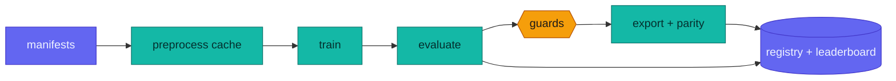

# Training and testing pipeline (design contract)

**Goal:** never redo work. Every expensive step runs once per unique input,
every result is recorded once, and every agent or person submits work the same
way. The pipeline is a small content-addressed DAG with a single GPU queue.

## 1. Content-addressed steps (skip if already done)

Each step has a **key** = SHA-256 over its exact inputs. Its output directory is
`runs/<step>/<key[:12]>/` and contains `done.json` (inputs, outputs and their
hashes, timings, environment). If `done.json` exists and its output hashes
verify, the step is **skipped**.

| Step | Key inputs | Output |
|---|---|---|
| `manifest` | dataset files' SHA-256 + indexer version | `data/manifests/*.jsonl` |
| `cache` | manifest rows used + preprocessing version + params (ridge period target, canvas size, estimator) | uint8 canvas `.npz` + per-image period/extent |
| `train` | resolved config + cache key(s) + code version (git commit + dirty-diff hash) + seed | checkpoints (`best.pt` by val, `last.pt`), `metrics.jsonl`, plots |
| `eval` | checkpoint SHA-256 + protocol version + test-set list | per-set JSON (EER fvc/all, FMR100, FMR1000, ZeroFMR, rank-1, latency, FTE) |
| `export` | checkpoint SHA-256 + exporter version + format (ONNX FP32/INT8, LiteRT FP16/INT8) | model files + parity report (cosine vs PyTorch, EER re-measured) |

Changing one thing re-runs only what depends on it. A new eval protocol reuses
every checkpoint; a new augmentation reuses every cache.

## 2. One GPU queue

- Jobs are YAML files submitted to `runs/queue/pending/` (`python -m training.queue submit cfg.yaml --priority N`).
- A single worker (`python -m training.queue worker`) owns the GPU and runs one job at a time: pending → running → done/failed.
- Jobs whose `train` key is already done are resolved immediately (deduplication).
- Crash recovery: checkpoint every epoch plus optimizer/EMA/scheduler state, and auto-resume on restart.
- Guards abort a job on a non-finite storm (> 20 skipped steps), a stall (no step for 20 min) or OOM. The failure reason is recorded in the registry.
- The training agent, the baseline agent and humans all submit through the queue, so nobody fights over the GPU.

## 3. Sweeps without manual babysitting

A sweep spec (`sweeps/<name>.yaml`) declares a base config, a search space and a
budget. The scheduler uses **successive halving**:

1. Submit N short runs (e.g. 6 epochs).
2. Read val metrics from the registry and promote the top half.
3. Repeat until one config remains, then submit the long run.

Every trial is an ordinary queued job, so trials already run are reused.

## 4. Evaluation is shared and guarded

- One evaluator (`fingerprint_from_image.evaluation`) for every model: ours, the reproduced SOTA baseline, comparators (SourceAFIS, Ridgeformer, foundation-model zero-shot).
- **Held-out guard (enforced in code):** the training data loader refuses any manifest row with `split == heldout`. The set of held-out identities is hashed and recorded in every `train` `done.json`. Evaluation checks that hash and refuses a checkpoint whose training data overlapped the test set.
- **Selection guard:** checkpoint and threshold selection read `val` identities only. Test metrics are computed once per checkpoint and never fed back into selection.
- Standard test suite per checkpoint: FVC2004 DB1–4 B (comparable with the classic/SourceAFIS table) and FVC2004 full (110 fingers/DB, plus DB_A-only for published DB_A numbers).

## 5. Registry and leaderboard

- `runs/registry.sqlite`: one row per step execution, holding key, step, status, config, git commit, metrics, artifact paths, licence lineage (data + weights licences, so "open" vs "research-only" is computed rather than remembered).
- `python -m training.report` regenerates `benchmarks/LEADERBOARD.md` and its plots (DET curves, per-sensor EER bars, training curves) from the registry. README tables are generated from the same source, never typed by hand.

## 6. Reproducibility

Each `train` record stores seed, resolved config, git commit + dirty diff,
library versions, GPU/driver, and data cache keys. Any leaderboard row can be
re-run with `python -m training.queue rerun <key>`, which yields the same key
and therefore a skip unless `--force` is given.

## 7. Implementation order

1. Content keys + `done.json` + skip logic for `cache`, `train`, `eval`.
2. GPU queue worker with resume and guards; route all training through it.
3. Registry + `training.report` leaderboard generation.
4. Successive-halving sweep scheduler.
5. Export/parity step and licence lineage.

Each piece gets unit tests (key stability, skip and invalidation, queue state
transitions, held-out guard rejecting a contaminated manifest).
